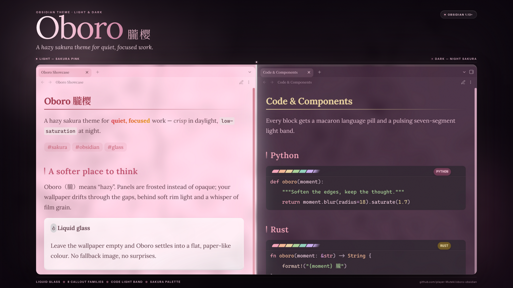
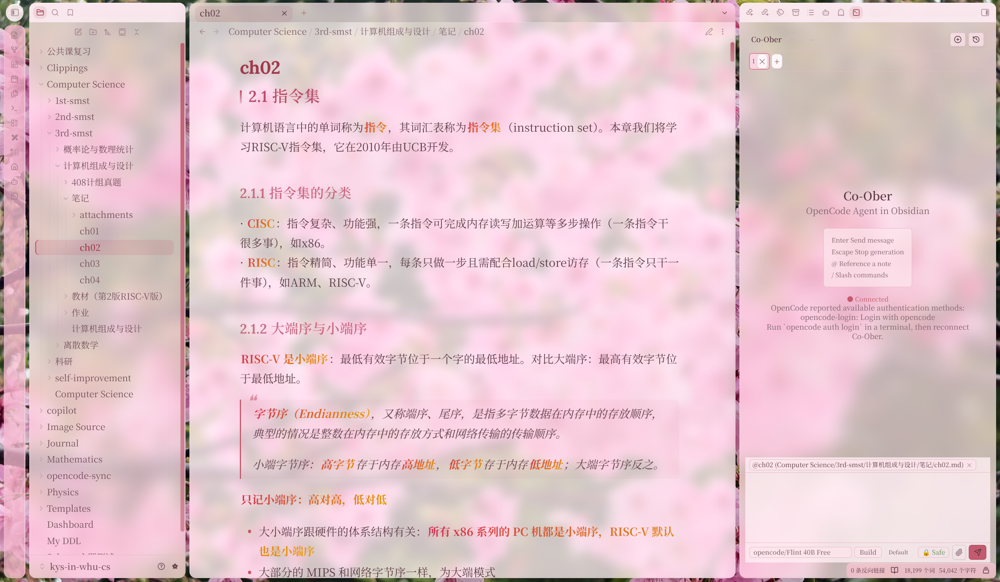
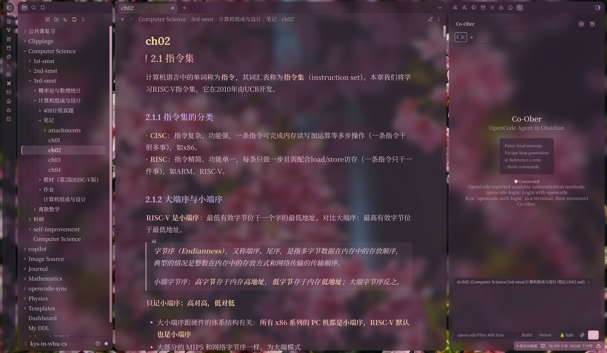

# Oboro · 朧樱

Obsidian 双模式主题：浅色是清透的**樱粉**，深色是低饱和护眼的**夜樱**。
面板半透明 + 毛玻璃，可透出壁纸；代码块顶部有七段脉冲光带，语言名渲染成马卡龙胶囊。

🌐 [English](README.md)

配套的 VS Code 主题 [sakura-macaron](https://github.com/player-Muteki/sakura-macaron) 同出一套配色——
一个主题，两个编辑器。

## 预览



樱粉（浅色）：



夜樱（深色）：



## 特性

- **双模式调色板**：樱粉 / 夜樱严格对称，各级文字对比度分档（正文 / 次要 / 极淡 / 强调）。
- **组件个性化**：马卡龙任务框与任务状态文字、玻璃 callout（8 组类型色）、引用块左缎带、
  樱花分隔线 ❀、三级列表圆点、图片圆角卡片、笔记嵌入玻璃卡、关系图色板，
  以及 tooltip / 菜单 / 弹窗 / 命令面板 / 输入框 / 开关 / 滑条等全套界面控件。
- **壁纸引擎**：面板半透明 + 液态玻璃，壁纸透出边缘花影；无壁纸时为纯色底（不内置兜底渐变）。
  **面板实度 / 玻璃模糊 / 饱和度提升 / 亮度提升 / 壁纸**均可在 Style Settings 实时调节。
- **代码块七段脉冲光带**：倾斜 30° 的分段渐变条，白光每 3.5s 扫过一次；浅色是樱花粉系，深色取自夜樱语法色板。
- **语言胶囊**：C / C++ / C# / x86 / ASM / Verilog / Java / Python / Rust 九种语言的代码块右上角显示马卡龙配色胶囊，对比度全部 ≥ 4.5:1。
- **渐变加粗**：浅色「莓红→金」、深色「樱玫→奶油金」，带行内代码拯救补丁与打印/PDF 实色回退。
- **六级标题色阶梯** + 标题衬线字体（Lora → 思源宋体 → 宋体系列）。
- **工程化**：官方 stylelint 规则校验、GitHub Actions lint + 标签自动发版、全部 `color-mix` 声明带实色兜底（旧内核自动回退）、移动端背景定位适配。

## 色板速览

| 角色 | 浅色·樱粉 | 深色·夜樱 |
| --- | --- | --- |
| 编辑器背景 | `#FFF0F5` | `#3C2D3C` |
| 侧栏背景 | `#FDE4EC` | `#352737` |
| 活动栏 | `#F8BBD0` | `#281F2B` |
| 状态栏 | `#F8BBD0` | `#AD7F96` |
| 正文 | `#5E3A46` | `#EBC4D7` |
| 强调色 | `#C45A6D` | `#E3B1C9` |
| 关键字 | `#BB2557` | `#F3A4B8` |
| 字符串 | `#3C7016` | `#ACD39A` |

## 安装

### 手动安装

1. 下载 [`theme.css`](./theme.css) 与 [`manifest.json`](./manifest.json)。
2. 在库中创建 `.obsidian/themes/Oboro/` 目录，把两个文件放进去。
3. 设置 → 外观 → 主题，选择 **Oboro**。

或直接 clone 本仓库后运行：

```bash
./scripts/install.sh /path/to/vault .obsidian   # 第二参数按需换成 .obsidian_pc 等
```

### 社区市场

（提交审核中，上架后可直接从 设置 → 外观 → 主题 → 浏览 安装。）

## 壁纸配置

主题默认**不内置任何背景图**——壁纸留空即为纯色底。想要壁纸，两种方式任选：

1. **Style Settings 插件**（推荐）：安装 [Style Settings](https://github.com/mgmeyers/obsidian-style-settings)，
   在其设置面板的 *Oboro* 区填入浅色 / 深色壁纸的
   `background-image` 值，例如 `url("https://example.com/bg.jpg")`。
2. **脚本注入**：在任意可执行脚本的场景（如主页 dataviewjs）向 `body` 注入
   `--dv-light-bg` / `--dv-dark-bg`，内联样式优先生效——两个通道可并存。

> 玻璃的透亮观感依赖壁纸后的图像细节：壁纸留空时为纯色底，毛玻璃效果会明显变平。

另有「关闭代码块顶部光带」开关。

## 开发

```bash
npm install
npm run lint          # stylelint-config-obsidianmd（社区审核同款规则）
./scripts/install.sh /path/to/vault .obsidian_linux
```

改完 `theme.css` 装回测试库，命令面板运行「重新加载」即可热更新。
发版与上架流程见 [docs/maintenance.md](./docs/maintenance.md)。

## 兼容性

- 最低 Obsidian **1.13.0**。
- 面板半透明使用 `color-mix()`（Chromium 111+）；不支持时自动回退实色，布局不受影响。
- 移动端（iPad 等）`(hover: none)` 下背景回退为随内容定位，规避 WKWebView 的 fixed 背景问题。
- 主题不加载任何远程资源；壁纸由用户自行配置。

## License

[MIT](./LICENSE)
